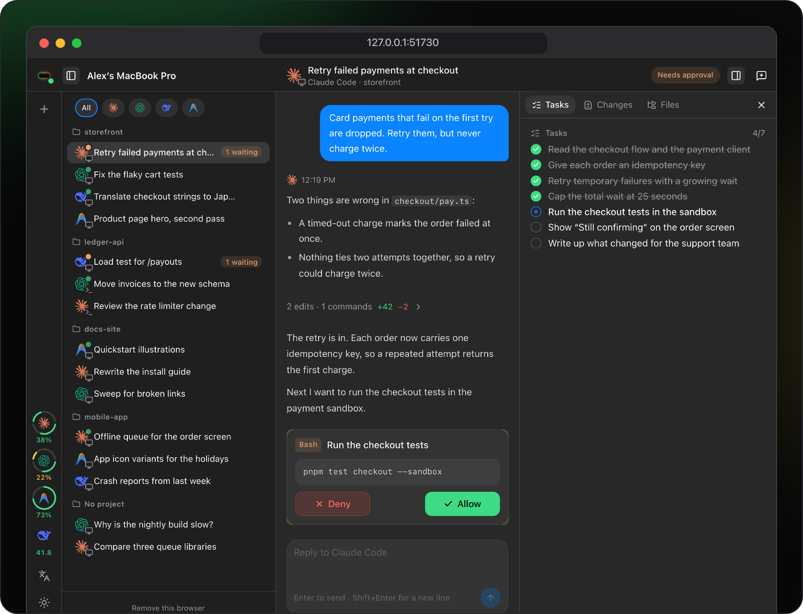
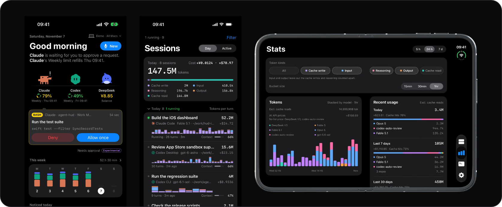
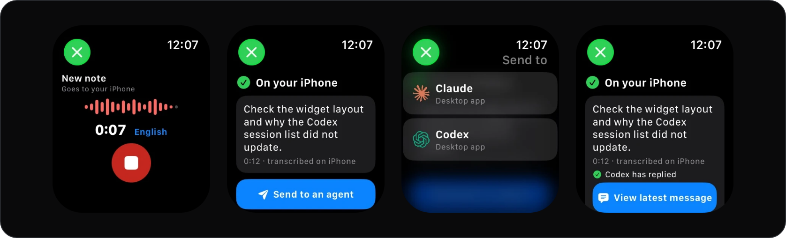
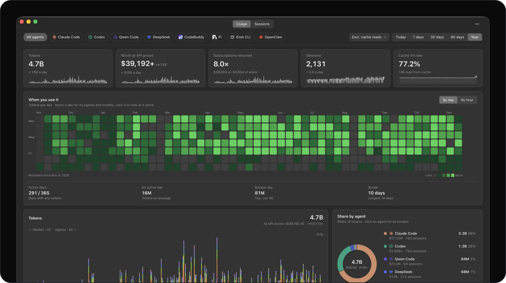

<h1 align="center">Agent HUD</h1>

<p align="center">
  <strong>One workbench for your AI agents.</strong><br>
  On your screen. On your phone. On your wrist.
</p>

<p align="center">
  <a href="https://agenthud.app/mac"></a>
  <a href="https://apps.apple.com/app/id6812113619"></a>
  <a href="docs/build-from-source.md"></a>
</p>

<p align="center">
  <strong>English</strong> · <a href="README.zh-CN.md">简体中文</a> · <a href="https://agenthud.app">Website</a> · <a href="https://discord.gg/cpTPDgWwXR">Discord</a> · <a href="#supported-agents">Supported agents</a> · <a href="docs/README.md">Documentation</a>
</p>

<p align="center">
  <br>
  <sub>Every agent's sessions in one page, served by your own computer · Sample data</sub>
</p>

Your agents work on your computer. Agent HUD puts them in one place: see who is working and who is waiting, pick up a conversation, make the next decision. At your desk, and after you leave it.

## Install

```sh
brew install --cask jazzenchen/tap/agent-hud     # Mac, with Homebrew
npx @agenthud/install                            # Mac, Windows or Linux, with Node.js
```

Or download the [release](https://agenthud.app/mac). If Agent HUD is useful to you, a star helps other people find it.

## One workbench, in any browser.

**Every session, in one place.** The [release](https://agenthud.app/mac) serves the page above from your own computer. Open it on this computer, or on a phone, tablet or another computer on the same network.

- **See who is waiting**: every session, grouped by project, with its agent's mark.
- **Approve right there**: allow or deny a tool call, answer a question, reply, or start a new session.
- **Follow the work**: the plan as it advances, and what the agent changed in each file.

## On your screen.

**Your agents, at a glance.** The edge of your screen tells you who is still busy, who is done and who is waiting for you.

<p align="center">
   <br>
  <sub>Notch mode at a MacBook's notch · Simple mode on any screen edge · Sample data</sub>
</p>

- **Glow**: one colour per agent, from its most used quota. Green, yellow from 70% used, red from 90%.
- **Hover**: quotas with their resets, balances, the last 24 hours of tokens, and the sessions.
- **Requests**: approve, deny or answer right on the HUD, then jump back to the session in one click.

## On your phone.

**Keep moving when decisions are needed.** On iPhone, check progress, read replies and continue the conversation. When an agent reaches something only you can decide, you answer it there.

<p align="center">
  
</p>

## On your wrist.

**Start from your wrist, continue on iPhone.** Raise your wrist and say an idea, and it becomes a session on the Mac at home. The reply comes back to your watch.

<p align="center">
  <br>
  <sub>A note spoken to Apple Watch becomes a Codex session on the Mac · Phone and watch away from home need <a href="#agent-hud-remote">Agent HUD Remote</a></sub>
</p>

## Let your agents talk to each other.

**Your agents use Agent HUD too.** Through its built-in MCP server, Claude Code can ask a Codex session to review a change and get the answer back, or start a new session and hand the task over.

- **A message, not the conversation**: only what the agent writes goes across. The project itself is the shared context.
- **Build your own UI**: tell an agent how you want the HUD to look, see the preview, and keep it with **Save**.

[Agents messaging each other](https://agenthud.app/docs/en/mcp/messaging/)

## Supported agents

<p align="center">
  <picture>
    <source media="(prefers-color-scheme: dark)" srcset="docs/videos/agent-bots-row-dark.webp">
    
  </picture>
</p>

Install and sign in to the agents you want to follow; Agent HUD finds them by itself. All 27 show tokens and sessions. These four do everything:

| Agent | Quota | Live status | Approvals | Questions | Replies | One click back | Agent messages |
| --- | :---: | :---: | :---: | :---: | :---: | :---: | :---: |
| **Claude&nbsp;Code** | ✓ | ✓ | ✓ | ✓ | ✓ | ✓ | ✓ |
| **Codex** | ✓ | ✓ | ✓ | ✓ | ✓ | ✓ | ✓ |
| **Antigravity** | ✓ | ✓ | ✓ | ✓ | ✓ | ✓ | ✓ |
| **DeepSeek&nbsp;Harness** | Balance | ✓ | ✓ | ✓ | ✓ | Window | ✓ |

<details>
<summary><strong>The other 23 agents, and what works with each</strong></summary>

| Agent | Tokens and sessions | Quota | Live status | Approvals | Questions | Replies | One click back | Turns and calls | Agent messages |
| --- | :---: | :---: | :---: | :---: | :---: | :---: | :---: | :---: | :---: |
| **Claude&nbsp;Code** | ✓ | ✓ | ✓ | ✓ | ✓ | ✓ | ✓ | ✓ | ✓ |
| **Codex** | ✓ | ✓ | ✓ | ✓ | ✓ | ✓ | ✓ | ✓ | ✓ |
| **DeepSeek&nbsp;Harness** | ✓ | Balance | ✓ | ✓ | ✓ | ✓ | Window | ✓ | ✓ |
| **Antigravity** | ✓ | ✓ | ✓ | ✓ | ✓ | ✓ | ✓ | ✓ | ✓ |
| **Cursor** | ✓ | ✓ | ✓ |  |  | ✓ | ✓ |  | Limited |
| **Grok&nbsp;CLI** | ✓ | ✓ | ✓ |  |  | ✓ |  |  |  |
| **Grok&nbsp;Bot** | ✓ | ✓ | ✓ |  |  | ✓ | ✓ |  |  |
| **GitHub&nbsp;Copilot&nbsp;CLI** | ✓ | ✓ | ✓ | ✓ |  | ✓ |  |  |  |
| **OpenCode** | ✓ | ✓ |  |  |  | ✓ | ✓ |  | ✓ |
| **Kilo&nbsp;Code** | ✓ |  |  |  |  | ✓ | ✓ |  |  |
| **MiMo&nbsp;Code** | ✓ |  |  |  |  | ✓ | ✓ |  |  |
| **Kimi** | ✓ | ✓ | ✓ |  |  | ✓ |  |  | Limited |
| **Pi** | ✓ | ✓ | ✓ |  |  | ✓ | ✓ |  | ✓ |
| **Oh&nbsp;My&nbsp;Pi** | ✓ |  | ✓ |  |  | ✓ | ✓ |  |  |
| **OpenClaw** | ✓ |  |  |  |  |  |  |  |  |
| **Hermes&nbsp;Agent** | ✓ | ✓ | ✓ |  |  | ✓ |  |  |  |
| **Factory&nbsp;Droid** | ✓ | ✓ | ✓ | ✓ |  | ✓ |  |  |  |
| **TRAE** | Sessions | ✓ | ✓ |  |  | ✓ |  |  | Limited |
| **Qoder** | ✓ | ✓ | ✓ | ✓ |  | ✓ |  | ✓ | Limited |
| **ZCode** | ✓ |  | ✓ | ✓ | ✓ | ✓ |  |  | Limited |
| **CodeBuddy** | ✓ |  |  | ✓ |  | ✓ |  |  |  |
| **WorkBuddy** | ✓ | ✓ |  | ✓ |  | ✓ |  |  | Limited |
| **Qwen&nbsp;Code** | ✓ |  |  | ✓ |  | ✓ |  |  |  |
| **Devin** | ✓ | ✓ |  | ✓ |  | ✓ | ✓ |  |  |
| **Cline** | ✓ | ✓ |  |  |  |  |  |  |  |
| **Roo&nbsp;Code** | ✓ |  |  |  |  |  |  |  |  |
| **Goose** | ✓ |  |  |  |  |  |  |  |  |

**Limited** messaging means a message goes in only when one of the session's turns ends: an idle session does not get it until you start another turn there.

Also: the **GLM Coding Plan**, **OpenCode Go**, **MiniMax** and **Volcengine Ark** plan quotas. Qoder includes Qoder CN and QoderWork, TRAE includes TRAE CN, and Devin includes the CLI and Devin Desktop. Codex CLI approvals need its hook trusted in Codex (the Codex app's need nothing), DeepSeek Harness approvals and questions need Agent HUD's plugin (Settings → Agent plugins), and Copilot's approvals and quota are each turned on in Settings. Qoder's, WorkBuddy's and TRAE's quotas show once you sign in to the vendor's site in Agent HUD's own window. TRAE reports no tokens, so only its sessions show, and it runs Agent HUD's hooks once you turn on its global hooks. Qoder records tokens, and so its turns, only for a model on your own key or with `QODER_EXPOSE_TOKEN_USAGE` set. A jump back to a terminal pane needs iTerm2, and Cursor opens a cloud agent's chat but only a local chat's folder. DeepSeek Harness's one click back brings its desktop app's window forward on macOS and Windows, not the session itself; on Windows the link already names the session, for when Harness supports it. An agent marked Limited under [Agent messages](https://agenthud.app/docs/en/mcp/messaging/) takes a message only when one of its turns ends, not while idle, and cannot be started in a new session; only an interactive Qoder CLI session takes one while idle. OpenCode 2, Qoder CN and QoderWork take agent messages without sending them. Factory Droid's quota needs a Factory API key, and Devin's quotas come from its CLI's local cache. Cursor's tokens come from Cursor 3.27 or later. Grok Bot's bots run on Cursor's servers, which report each bot's daily tokens; an account merged into SuperGrok reports none, so only its sessions show. Grok Bot's weekly quota comes from the same servers when Cursor is signed in to the Bot's account, otherwise from the Bot's own cache, which it refreshes only while in use. An account merged into SuperGrok has one weekly limit for Cursor and Grok Bot, and Cursor's block shows it as Cursor does.

</details>

## Know your token usage.

**Quotas tell you how much is left. Token usage shows you how it was spent**: which agents, models and sessions, and how that changed over time.

<p align="center">
  
</p>

| Dimension | What you can track |
| --- | --- |
| **Time** | Today, the last 7, 30 or 90 days, or a year. Every token stays on your computer. |
| **Agents&nbsp;and&nbsp;models** | Each agent's share, tokens and cost, and the models behind them. |
| **Sessions&nbsp;and&nbsp;turns** | A session's tokens with its sub-agents' part, context fill and cache hits. |
| **Cost&nbsp;and&nbsp;plans** | An estimate at list price, and what each plan's usage would cost at API prices. |

## Small footprint.

**A HUD runs all day, so staying light is part of the experience.** Measured on a real Mac while idle, not claimed:

<!-- Numbers come from release builds measured as docs/performance.md describes. -->
<table>
  <tr>
    <td align="center" width="33%"><h3>about 7%</h3>of one CPU core</td>
    <td align="center" width="33%"><h3>about 240 MB</h3>of memory</td>
    <td align="center" width="33%"><h3>about 0.1 Wh</h3>over an 8-hour day</td>
  </tr>
</table>

Built with Tauri 2: a Rust core, a React interface, and a thin native layer for each system. macOS and Windows today; Linux in preview. [How it is measured](docs/performance.md#measured-footprint)

## Agent HUD Remote.

**Your agents, wherever you are.** On the same network everything marked ✓ is free. Remote carries it to any network through your own iCloud, and adds what is marked ★.

| | iPhone | Apple Watch |
| --- | :---: | :---: |
| Quotas, balances, token statistics and sessions | ✓ | ✓ |
| Conversations, and messages to your agents | ★ | ★ |
| Tool calls, questions and plans | ★ | ★ |
| A spoken note that becomes a new session | ★ | ★ |
| Alerts and Live Activities | ★ | ★ |

<sub>✓ Free to use · ★ Needs a subscription</sub>

**Check out in the App Store**, inside the iPhone app: [China mainland](https://apps.apple.com/cn/app/agent-hud/id6812113619) · [International](https://apps.apple.com/us/app/agent-hud/id6812113619)

## Keep your data safe.

- **Read on your computer**: the records your agents already keep. Usage history stays in a local database.
- **Read from each vendor**: quotas and balances, with the agent's existing sign-in. No read sends a message to a model.
- **Uploaded**: nothing, by a build from this source.

What the release sends to your iPhone and Apple Watch, and how it is encrypted: [your data](docs/data.md).

## More

[Coming soon](docs/roadmap.md) · [Common questions](docs/common-questions.md) · [Build from source](docs/build-from-source.md) · [Documentation](docs/README.md) · [Discord](https://discord.gg/cpTPDgWwXR) · [WeChat group](docs/community.md) · [Apache-2.0](LICENSE)
