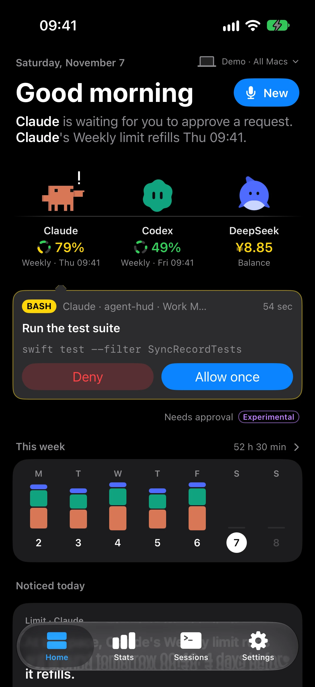
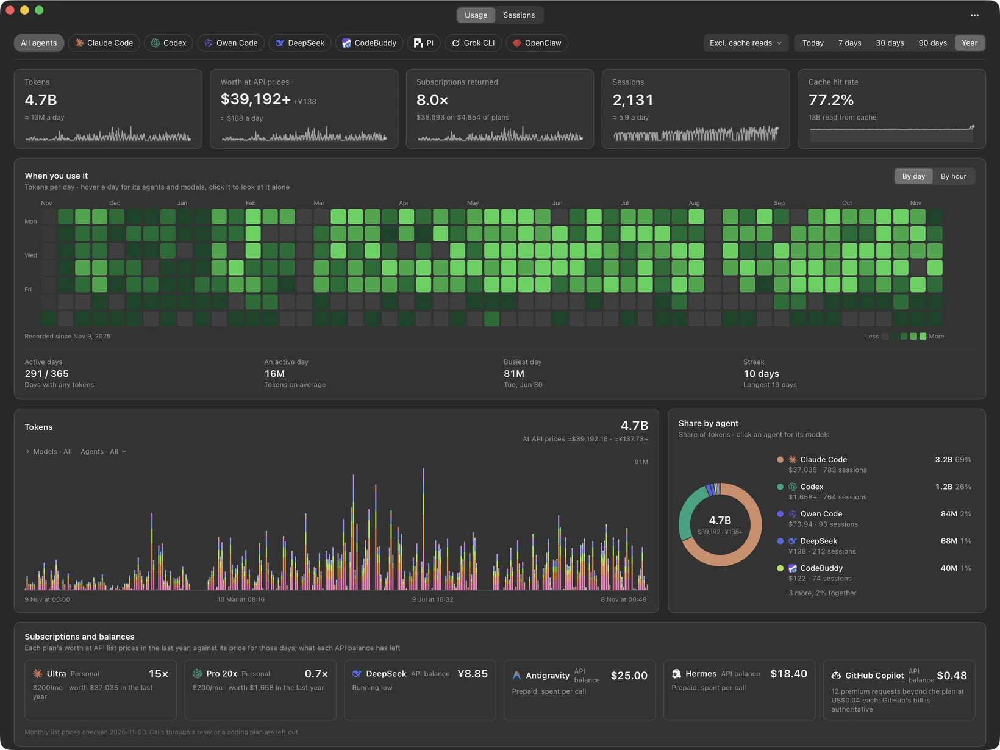
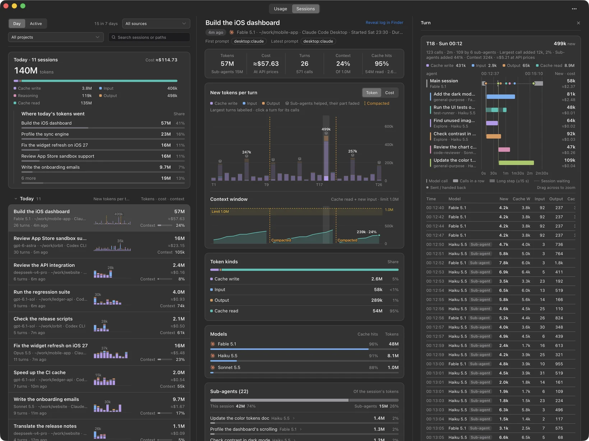

<h1 align="center">Agent HUD</h1>

<p align="center">
  <strong>Ajanlarınız için HUD.</strong><br>
  Ekranınızda. Telefonunuzda. Bileğinizde.
</p>

<p align="center">
  <a href="https://agenthud.app/mac"></a>
  <a href="https://apps.apple.com/app/id6812113619"></a>
  <a href="#kaynaktan-derleme"></a>
</p>

<p align="center">
  <a href="#kurulum"></a>
  <a href="#her-masaüstü-için-üretildi"></a>
  <a href="docs/platform-architecture.md"></a>
  <a href="LICENSE"></a>
</p>

<p align="center">
  <a href="README.md">English</a> · <a href="README.zh-CN.md">简体中文</a> · <strong>Türkçe</strong> · <a href="https://agenthud.app">Web Sitesi</a> · <a href="https://discord.gg/cpTPDgWwXR">Discord</a> · <a href="#topluluk">WeChat grubu</a> · <a href="#desteklenen-ajanlar">Desteklenen ajanlar</a> · <a href="#sıkça-sorulan-sorular">Sıkça sorulan sorular</a> · <a href="#belgeler">Belgeler</a>
</p>

<p align="center">
   <br>
  <sub>Sol: MacBook çentiğinde Çentik modu · Sağ: Ayrı ajanlar açıkken ekranın sol kenarında Basit mod · Örnek veri</sub>
</p>

<p align="center">Agent HUD işinize yarıyorsa, vereceğiniz bir yıldız başkalarının da onu bulmasına yardımcı olur.</p>

Ajanlarınız Mac'inizde çalışır. Agent HUD onların ilerlemesini size getirir. Tek bakışta nerede olduklarını görün, bir sohbete kaldığınız yerden devam edin, bir sonraki kararı verin: masanızdayken ve masanızdan ayrıldıktan sonra.

## Kurulum

Mac'te Homebrew ile:

```sh
brew install --cask jazzenchen/tap/agent-hud
```

Mac, Windows veya Linux'ta Node.js ile ([nasıl kurulur](src/apps/installer/README.md)):

```sh
npx @agenthud/install
```

Veya [sürümü](https://agenthud.app/mac) indirin. Her iki komut da betalar dahil en yeni sürümü kurar ve Mac'te Agent HUD sonrasında kendini günceller. Zaten `/Applications` içindeyse Homebrew komutuna `--adopt` ekleyin.

Yeni misiniz? [Ajanların birbirleriyle mesajlaşması](https://agenthud.app/docs/en/mcp/messaging/) ve [her platformda nelerin çalıştığı](docs/platforms.md) ile başlayın.

## Ekranınızda.

**Ajanlarınız, tek bakışta.** Siz kod yazarken, belge okurken veya başka bir şeyle ilgilenirken ajanlarınız çalışmaya devam eder. Ekranınızın kenarı kimin hâlâ meşgul olduğunu, kimin işini bitirdiğini ve kimin sizi beklediğini söyler.

Ayrıntılar elinizin altındadır ve onayınızı bekleyen şeyler tam orada yanıtlanır. Her ajanın ilerlemesi, tek bir bakışla kavrayabileceğiniz yerde toplanır.

- **Parıltı**: en çok kullanılan kotasına göre ajan başına bir renk: %70 altında yeşil, %70'ten itibaren sarı, %90'dan itibaren kırmızı; kota dolmadan önce uyarıyla birlikte. Bir ajan çalışırken daha hızlı hareket eder.
- **Üzerine gelme**: sıfırlanma süreleri veya tüketim hızlarıyla kotalar, bakiyeler, son 24 saatin token'ları ve önce sizi bekleyenler olmak üzere oturumlar.
- **İstekler**: Claude'un kendi masaüstü uygulamasında sorduğu sorular da dahil olmak üzere, doğrudan HUD üzerinden onaylayın, reddedin veya her zaman izin verin ve bir ajanın sorduğu herhangi bir soruyu yanıtlayın. Otomatik onayla açıkken Agent HUD izin isteklerine sizin yerinize izin verir.
- **Geri atlama**: tek tık sizi bir oturumun konusuna, sekmesine veya terminal bölmesine götürür.

**İki mod.** Her ekran birini çalıştırır: çentik olan yerde varsayılan olarak Çentik (Notch), diğer yerlerde Basit (Simple).

| Mod | Ekranda |
| --- | --- |
| **Notch** | Çentikte, etrafında parıltıyla. |
| **Simple** | Herhangi bir ekran kenarında küçük bir yüzer panel: en çok kullanılan kotasının halkası içinde her ajanın logosu ve yanında yüzdesi. Ajanı çalışırken logo kendi botuna dönüşür. |

Bir ekran ayrıca HUD'unu ya da yalnızca mesajlarını, isteklerini veya kağıt uçaklarını gizleyebilir: Settings → Display.

## Telefonunuzda.

**Karar gerektiğinde ilerlemeye devam edin.** Bilgisayarınızdan ayrılın, iş yine de sizinle gelsin. iPhone'da ilerlemeyi kontrol edin, yanıtları okuyun ve sohbete devam edin.

Bir ajan yalnızca sizin karar verebileceğiniz bir noktaya ulaştığında telefonunuz size bağlamı gösterir; siz de soruyu yanıtlar veya bir sonraki adımı onaylarsınız. Görev devam eder, gününüz de öyle. iPhone Duo desteklenir.

<p align="center">
  <a href="docs/screenshots/iphone-home.webp"></a> <a href="docs/screenshots/iphone-sessions.webp"></a> <a href="docs/screenshots/iphone-duo-stats.webp"></a><br>
  <sub>iPhone için Agent HUD · Ana Ekran ve Oturumlar ile açılmış bir iPhone Duo'da İstatistikler · Örnek veri</sub>
</p>

Bkz. [Agent HUD Remote](#agent-hud-remote).

## Bileğinizde.

**Bileğinizden başlayın, iPhone'da devam edin.** Yürüyüşte aklınıza bir fikir gelir. Bileğinizi kaldırın, söyleyin; doğrudan evdeki Mac'e gider. Geçerken yakalanan bir düşünce, devam eden bir göreve dönüşür.

En son yanıtı saatinizde okuyun. Üzerinde tartışmak veya ayrıntı eklemek için iPhone'da devam edin. Fikir bileğinizde başlar ve sohbet siz nereye giderseniz oraya gider.

<p align="center">
     <br>
  <sub>Apple Watch'a söylenen bir not Mac'te bir Codex oturumuna dönüşür · Örnek veri</sub>
</p>

Bkz. [Agent HUD Remote](#agent-hud-remote).

## Yerleşik MCP.

**Ajanlarınız da Agent HUD kullanır.** Yerleşik MCP sunucusu, onlara birbirleriyle konuşabilecekleri bir kanal ve istediğiniz arayüzü oluşturacak araçlar sunar.

### Ajanlarınızın birbirleriyle konuşmasını sağlayın.

Claude Code bir değişikliği bitirdiğinde, bir Codex oturumundan onu incelemesini isteyebilir ve Codex'in yanıtını geri alabilir ya da yeni bir oturum başlatıp görevi devredebilir. Agent HUD zaten her oturumu gördüğü için mesajları istemciler arasında taşır.

Kimin kime konuştuğunu izleyebilirsiniz: gönderen mesajını bir kağıt uçağa katlayıp alıcının işaretine doğru uçurur ve yanıt da aynı şekilde geri uçar.

- **Sohbetin tamamı değil, yalnızca bir mesaj**: yalnızca ajanın yazdığı şey karşıya geçer; oturumu olduğu yerde kalır. Tek bir projede projenin kendisi paylaşılan bağlam hâline gelir ve diğer ajan kodu kendi başına okur.
- **On iki ajan**: Claude Code, Codex, Antigravity, DeepSeek Harness, Cursor, TRAE, WorkBuddy, ZCode, Qoder, Kimi Code, Pi ve OpenCode birbirlerine mesaj gönderebilir ya da yeni bir Claude Code, Codex, Antigravity veya DeepSeek Harness oturumu başlatabilir.
- **Varsayılan olarak kuyruğa alınır**: bir mesaj, oturumu boşta kalana kadar bekler. Yalnızca siz istediğinizde bir ajan mesajı devam eden bir Codex veya DeepSeek Harness oturumunun turuna yönlendirebilir.
- **Altısı sınırlıdır**: Cursor, TRAE, WorkBuddy, ZCode, Qoder ve Kimi Code mesajı yalnızca turlarından biri bittiğinde alır; bu nedenle boşta olan bir oturum mesajı orada başka bir tur başlattıktan sonra alır. WorkBuddy dışındakiler arka arkaya kaç mesaj alacaklarını da sınırlar.

Nasıl açılır ve kullanılır: [Ajanların birbirleriyle mesajlaşması](https://agenthud.app/docs/en/mcp/messaging/).

### Kendi arayüzünüzü oluşturun.

Bir ajana işleri nasıl görmek istediğinizi söyleyin: *“Codex'i en başa koy ve yalnızca önemsediğim sayıları tut.”*

MCP aracılığıyla ajan Mac HUD'unuzu yeniden düzenler, ne gösterdiğini ve nasıl göründüğünü değiştirir. Değişiklik anında bir önizleme olarak görünür ve yalnızca **Save** (Kaydet) düğmesine bastığınızda saklanır; böylece HUD çalışma biçiminize uyum sağlar.

- Claude Code, Codex ve diğer tüm MCP istemcileri için.
- Bir ajan HUD'u okuyabilir, herhangi bir ekran için bir düzen veya görünüm önerebilir ve sonucu hesapların maskelendiği bir ekran görüntüsüyle kontrol edebilir.
- Aynı araçlar, uygulamanın halihazırda tuttuğu verilerden kullanımınız, oturumlarınız ve istatistikleriniz hakkındaki soruları yanıtlar.

## Açık tutmaya değer

### Token kullanımınızı bilin.

Ajanlarınızın ne yaptığını ve ne kadar kullandığını bilin. Token kullanımınızı görün, zaman içinde nasıl değiştiğine bakın ve nereye gittiğini bulun: hangi ajanlar, modeller ve oturumlar.

Kotalar ne kadar kaldığını söyler. Token kullanımı nasıl harcandığını gösterir.

<p align="center">
  <br>
  <br>
  <sub>Mac'te İstatistikler · bir yıllık kullanım ve zaman çizelgesinde bir turun alt ajanları · Örnek veri</sub>
</p>

| Boyut | Neleri takip edebilirsiniz |
| --- | --- |
| **Zaman** | Bugün, son 7, 30 veya 90 gün ya da bir yıl. Her token bilgisayarınızda kalır; telefon 30 günü saklar. |
| **Token&nbsp;türleri** | Girdi, çıktı, akıl yürütme, önbellek yazmaları ve önbellek okumaları; hepsi birlikte veya herhangi bir karışım. |
| **Ajanlar&nbsp;ve&nbsp;modeller** | Her ajanın payı, token'ları ve maliyeti ile bunların arkasındaki modeller. |
| **Oturumlar** | Alt ajanların payıyla birlikte token'lar, maliyet, turlar, çağrılar, bağlam doluluğu ve önbellek isabetleri. Alt ajanlar kendilerini başlatan oturumun içinde sayılır. |
| **Turlar&nbsp;ve&nbsp;çağrılar** | Her turun yeni token'ları ve modeli, bağlamı ve istediği araçlarla her çağrı. |
| **Önbellek&nbsp;isabetleri** | Bugün, son 7 gün ve son 30 gün, her oturum ve bir oturum içindeki her model. |
| **Maliyet** | Her sağlayıcının Çin veya uluslararası fiyat listesinden, liste fiyatına göre ≈ ile işaretli bir tahmin. Bir fatura tutarı değildir. |
| **Planlar** | Her planın kullanımının API liste fiyatlarıyla ne kadar tutacağı ve planın fiyatıyla karşılaştırması. |
| **Etkinlik** | Ajanlarınızın ne zaman çalıştığı; bir yıl boyunca güne göre veya saate göre tek bir ısı haritasında. |
| **Kotalar** | Her kota penceresinin gün gün ne kadar dolduğu ve nerede sıfırlandığı. |
| **Bakiyeler** | DeepSeek'in günlük harcaması ve bakiyesinin tükeneceği gün. |

### Ajanlarınızın canlandığını görün.

Tanıdık ajan logoları, düşünmeyi, çalışmayı ve beklemeyi canlandıran küçük botlara dönüşür. Her durumda bir yüz ifadesiyle, tek bir bakış neler olup bittiğini anlatır.

<p align="center">
  <picture>
    <source media="(prefers-color-scheme: dark)" srcset="docs/videos/agent-bots-row-dark.webp">
    
  </picture>
</p>

HUD'a kendine özgü bir karakter kazandırırlar: iş başında meşgul olan, size ihtiyaç duyduklarında işaret veren ajanlarınız. Her bot logosunun şeklini ve renklerini korur ve gözleriyle imlecinizi takip eder; Claude Code'unki Clawd'dur. [Her botun dört durumunu görün](docs/videos/agent-bots.webp).

### Küçük ayak izi. Mac'inizde hafif.

Bir HUD gün boyu çalışır, bu nedenle hafif kalmak deneyimin bir parçasıdır. Agent HUD CPU, bellek ve enerji kullanımını düşük tutar; sisteminizi ajanlarınıza ve önünüzdeki işe bırakır.

İddia değil, gerçek bir Mac'te ölçüldü:

<!-- Sayılar docs/performance.md belgesinde açıklandığı gibi sürüm derlemelerinden ölçülmüştür. -->
| Ölçüm | Boşta | Meşgul | Bileşenler |
| --- | --- | --- | --- |
| CPU, bir çekirdeğin payı | yaklaşık&nbsp;%7 | %7–&#8288;%28 | Agent HUD %6–11, her ekranın HUD'u %0,5–7, grafik ve ağ %5'e kadar |
| Bellek | yaklaşık&nbsp;240&nbsp;MB | 240–&#8288;260&nbsp;MB | Etkinlik Monitörü'nde göründüğü şekliyle Agent HUD'un kendi işlemi. Her ekranın HUD'u 70–170 MB, grafik 10–50 MB ve ağ 7 MB ekler |
| 8 saatlik bir günde enerji | yaklaşık&nbsp;0,1&nbsp;Wh | 0,1–&#8288;2,3&nbsp;Wh | Yarısından fazlası Agent HUD, geri kalanı HUD'lar ve grafik |

Boşta: çalışan ajan yok, bir ekran. Meşgul: günlüklerine yazan ajanlar, bir veya iki ekran. Yaklaşık 8.000 oturum günlüğüyle bir Apple M1 Max, macOS 26 üzerinde sürüm derlemeleri. [Nasıl ölçüldüğü](docs/performance.md#measured-footprint).

## Her masaüstü için üretildi

Agent HUD, Tauri 2 ile oluşturulmuştur: bir Rust çekirdeği, bir React arayüzü ve her işletim sistemi için ince bir yerel katman.

- **Tek çekirdek.** Ajanlarınızın kayıtlarını okuma, token'ları sayma ve kotaları, fiyatları ve oturumları hesaplama işi her sistemde aynı şekilde, bir kez Rust içinde yapılır. Pencereler yalnızca çekirdeğin hesapladığını gösterir.
- **Her sistem kendi dosyalarında.** Yollar, işlemler, kimlik bilgileri, kancalar ve pencereler sistem başına bir kez yazılır; böylece Windows veya Linux üzerindeki çalışmalar paylaşılan koda hiç dokunmaz.
- **Bugün macOS ve Windows; önizlemede Linux.** Üçü de bu kaynaktan derlenir ve her sürüm Windows ve Linux için imzasız paketler taşır. Linux derlemesi henüz gerçek bir masaüstünde denenmemiştir; eksik kalanlar [Yakında](#yakında) altındadır.
- **iPhone ve Apple Watch bir Mac veya Windows PC ile eşleşir.** Agent HUD Remote iCloud üzerinden eşitlenir, bu nedenle şimdilik yalnızca macOS'te kullanılabilir; Windows ile telefon aynı ağ üzerinden bağlanır.

## Agent HUD Remote.

**Nerede olursanız olun ajanlarınız yanınızda.** Kendi iCloud'unuz üzerinden Agent HUD Remote, iPhone ve Apple Watch'unuzu herhangi bir ağda [sürüme](https://agenthud.app/mac) bağlı tutar.

### Neler elde edeceksiniz

iPhone'unuz ve sürüm aynı ağı paylaştığında, iPhone ve Apple Watch abonelik gerektirmeden Mac'inizin kotalarını, token istatistiklerini ve oturumlarını gösterir. Remote şunları ekler:

- **Herhangi bir ağ**: evden uzaktayken de kotalarınız, token istatistikleriniz ve oturumlarınız.
- **Sohbetler**: Claude Code, Codex, Antigravity ve DeepSeek Harness oturumlarını okuyun ve Claude Code, Codex ve Antigravity'ye mesaj gönderin.
- **Kararlar**: bir araç çağrısına izin verin veya reddedin, bir soruyu yanıtlayın, bir planı onaylayın.
- **Bileğiniz**: söylediğiniz bir fikir Mac'inizde yeni bir oturuma dönüşür ve yanıt saatinize geri gelir.
- **Uyarılar ve Canlı Etkinlikler**: iPhone ve Apple Watch'ta uyarılar ile Kilit Ekranında ve Dynamic Island'da çalışan oturumlarınız.

| | iPhone | Apple Watch |
| --- | :---: | :---: |
| Kotalar, bakiyeler ve token istatistikleri | ✓ | ✓ |
| Oturumlar ve token'ları | ✓ | ✓ |
| Ana Ekran, Kilit Ekranı ve Beklemede araç takımları | ✓ | — |
| Birden fazla Mac | ✓ | ✓ |
| Sohbetler | ★ | ★ |
| Claude Code, Codex ve Antigravity'ye mesajlar | ★ | ★ |
| Yeni bir oturuma dönüşen bir not | ★ | ★ |
| Araç çağrıları, sorular ve planlar | ★ | ★ |
| Uyarılar | ★ | ★ |
| Canlı Etkinlikler olarak çalışan oturumlar | ★ | ★ |

<sub>✓ Kullanımı ücretsiz · ★ Abonelik gerektirir</sub>

iPhone uygulamasının içinden **App Store'da inceleyin**: [Çin anakarası](https://apps.apple.com/cn/app/agent-hud/id6812113619) · [Uluslararası](https://apps.apple.com/us/app/agent-hud/id6812113619)

## Yakında

- **Linux önizlemeden çıkıyor.** [Katkılar memnuniyetle karşılanır](CONTRIBUTING.md).
- Aşağıdaki tablodaki 27 ajanın ötesinde **daha fazla ajan**.
- **Token başına faturalandırılan API anahtarları**: planlarınızın kotalarının yanında kullanımları, harcamaları ve bakiyeleri.
- **Arayüz istem şablonları.** HUD'unuzu tek seferde yeniden şekillendiren hazır istemler.
- **Alt ajanların Gantt görünümü.** Bir oturumun sayfasında, bir turun her alt ajanı tek bir zaman ekseninde kendi şeridinde: ne zaman başladığı, ne kadar çalıştığı, ne kullandığı ve nelerin yan yana çalıştığı.
- **Ajanlar yalnızca HUD'u değil her ekranı şekillendirir**, resim arka planları ve özelleştirilebilir bir iPhone uygulamasıyla.
- Claude Code, Codex, Antigravity ve DeepSeek Harness'ın ötesinde **sohbette daha fazla ajan**.
- **Çift yönlü dosyalar.** Ajanlarınız iPhone'unuza dosya gönderir ve siz de iPhone'unuzdan ajanlarınıza dosya gönderirsiniz.
- **Doğrudan ajanlarınıza ses kayıtları.** Apple Watch veya iPhone'unuzdan bir kayıt olduğu gibi ajanınıza ulaşır.
- **HUD'un daha fazlası sizin seçiminiz**: Basit modun halkalarının ne gösterdiği (tüketim hızı, sıfırlanmaya kalan süre veya maliyet) ve hangi ajanların sizi uyarabileceği.
- **Her ajandan daha fazlası**: Grok CLI'ın tek tıkla geri dönüşü, OpenClaw'ın canlı durumu ve yanıtları, Devin'in ve Goose'un canlı durumu ve Goose'un yanıtları.
- İstemci kancaları önizlemeden çıktığında **kaynaktan derlemelerde HUD üzerinde istekler ve yanıtlar**.
- **HarmonyOS.** HarmonyOS telefonlar için bir uygulama incelemede: [sürüm](https://agenthud.app/mac) ile aynı ağda kotalarınız, token istatistikleriniz ve oturumlarınız, ana ekranda servis kartlarıyla.

…ve daha fazlası.

## Desteklenen ajanlar

Takip etmek istediğiniz ajanları kurun ve oturum açın; Agent HUD onları kendisi bulur.

| Ajan | Token'lar ve oturumlar | Kota | Canlı durum | Onaylar | Sorular | Yanıtlar | Tek tıkla geri dönüş | Turlar ve çağrılar | Ajan mesajları |
| --- | :---: | :---: | :---: | :---: | :---: | :---: | :---: | :---: | :---: |
| **Claude&nbsp;Code** | ✓ | ✓ | ✓ | ✓ | ✓ | ✓ | ✓ | ✓ | ✓ |
| **Codex** | ✓ | ✓ | ✓ | ✓ | ✓ | ✓ | ✓ | ✓ | ✓ |
| **DeepSeek&nbsp;Harness** | ✓ | Bakiye | ✓ | ✓ | ✓ | ✓ | Pencere | ✓ | ✓ |
| **Antigravity** | ✓ | ✓ | ✓ | ✓ | ✓ | ✓ | ✓ | ✓ | ✓ |
| **Cursor** | ✓ | ✓ | ✓ |  |  | ✓ | ✓ |  | Sınırlı |
| **Grok&nbsp;CLI** | ✓ | ✓ | ✓ |  |  | ✓ |  |  |  |
| **Grok&nbsp;Bot** | ✓ | ✓ | ✓ |  |  | ✓ | ✓ |  |  |
| **GitHub&nbsp;Copilot&nbsp;CLI** | ✓ | ✓ | ✓ | ✓ |  | ✓ |  |  |  |
| **OpenCode** | ✓ | ✓ |  |  |  | ✓ | ✓ |  | ✓ |
| **Kilo&nbsp;Code** | ✓ |  |  |  |  | ✓ | ✓ |  |  |
| **MiMo&nbsp;Code** | ✓ |  |  |  |  | ✓ | ✓ |  |  |
| **Kimi** | ✓ | ✓ | ✓ |  |  | ✓ |  |  | Sınırlı |
| **Pi** | ✓ | ✓ | ✓ |  |  | ✓ | ✓ |  | ✓ |
| **Oh&nbsp;My&nbsp;Pi** | ✓ |  | ✓ |  |  | ✓ | ✓ |  |  |
| **OpenClaw** | ✓ |  |  |  |  |  |  |  |  |
| **Hermes&nbsp;Agent** | ✓ | ✓ | ✓ |  |  | ✓ |  |  |  |
| **Factory&nbsp;Droid** | ✓ | ✓ | ✓ | ✓ |  | ✓ |  |  |  |
| **TRAE** | Oturumlar | ✓ | ✓ |  |  | ✓ |  |  | Sınırlı |
| **Qoder** | ✓ | ✓ | ✓ | ✓ |  | ✓ |  | ✓ | Sınırlı |
| **ZCode** | ✓ |  | ✓ | ✓ | ✓ | ✓ |  |  | Sınırlı |
| **CodeBuddy** | ✓ |  |  | ✓ |  | ✓ |  |  |  |
| **WorkBuddy** | ✓ | ✓ |  | ✓ |  | ✓ |  |  | Sınırlı |
| **Qwen&nbsp;Code** | ✓ |  |  | ✓ |  | ✓ |  |  |  |
| **Devin** | ✓ | ✓ |  | ✓ |  | ✓ | ✓ |  |  |
| **Cline** | ✓ | ✓ |  |  |  |  |  |  |  |
| **Roo&nbsp;Code** | ✓ |  |  |  |  |  |  |  |  |
| **Goose** | ✓ |  |  |  |  |  |  |  |  |

**Sınırlı** mesajlaşma, bir mesajın yalnızca oturumun turlarından biri bittiğinde içeri girmesi anlamına gelir: boşta olan bir oturum, siz orada başka bir tur başlatana kadar onu almaz.

Ayrıca: **GLM Coding Plan**, **OpenCode Go**, **MiniMax** ve **Volcengine Ark** plan kotaları. Qoder, Qoder CN ve QoderWork'ü içerir; TRAE, TRAE CN'yi içerir ve Devin, CLI ile Devin Desktop'ı içerir. Codex CLI onayları kancasının Codex içinde güvenilmiş olmasını gerektirir (Codex uygulamasınınki hiçbir şey gerektirmez), DeepSeek Harness onayları ve soruları Agent HUD'un eklentisini gerektirir (Settings → Agent plugins) ve Copilot'ın onayları ile kotası Settings içinden ayrı ayrı açılır. Qoder, WorkBuddy ve TRAE kotaları, Agent HUD'un kendi penceresinde sağlayıcının sitesinde oturum açtığınızda görünür. TRAE token bildirmez, bu nedenle yalnızca oturumları görünür ve genel kancalarını açtığınızda Agent HUD'un kancalarını çalıştırır. Qoder token'ları ve dolayısıyla turlarını yalnızca kendi anahtarınızdaki bir model için veya `QODER_EXPOSE_TOKEN_USAGE` ayarlıyken kaydeder. Bir terminal bölmesine geri atlama iTerm2 gerektirir ve Cursor bir bulut ajanının sohbetini açar ancak yalnızca yerel bir sohbetin klasörünü açar. DeepSeek Harness'ın tek tıkla geri dönüşü macOS ve Windows'ta oturumun kendisini değil masaüstü uygulamasının penceresini öne getirir; Windows'ta bağlantı şimdiden oturumu adlandırır, Harness desteklediğinde hazır olsun diye. [Ajan mesajları](https://agenthud.app/docs/en/mcp/messaging/) altında Sınırlı olarak işaretlenen bir ajan, mesajı boşta iken değil yalnızca turlarından biri bittiğinde alır ve yeni bir oturumda başlatılamaz; yalnızca etkileşimli bir Qoder CLI oturumu boşta iken alır. OpenCode 2, Qoder CN ve QoderWork ajan mesajlarını göndermeden alır. Factory Droid'in kotası bir Factory API anahtarı gerektirir ve Devin'in kotaları CLI'ının yerel önbelleğinden gelir. Cursor'ın token'ları Cursor 3.27 veya üzeri sürümlerden gelir. Grok Bot'un botları Cursor'ın sunucularında çalışır ve bu sunucular her botun günlük token'larını bildirir; SuperGrok ile birleştirilmiş bir hesap hiç bildirmez, bu nedenle yalnızca oturumları görünür. Grok Bot'un haftalık kotası, Cursor Bot'un hesabına giriş yapmışken aynı sunuculardan, aksi halde yalnızca kullanım sırasında yenilediği Bot'un kendi önbelleğinden gelir. SuperGrok ile birleştirilmiş bir hesabın Cursor ve Grok Bot için tek bir haftalık limiti vardır ve Cursor'ın bloğu bunu Cursor'ın yaptığı gibi gösterir.

## Verilerinizi güvende tutun.

- **Bilgisayarınızda okunanlar**: ajanlarınızın halihazırda tuttuğu kayıtlar. Kullanım geçmişi yerel bir SQLite veritabanında kalır.
- **Her sağlayıcıdan okunanlar**: ajanın mevcut oturumu veya yapılandırılmış anahtarıyla kotalar, bakiyeler ve Grok Bot'un günlük token'ları. Hiçbir okuma bir modele mesaj göndermez. Agent HUD yalnızca sizin kendiniz verdiğiniz şeyleri saklar: içine yazdığınız bir API anahtarı ve bir sağlayıcının sitesinde kendi penceresinde yaptığınız bir oturum açma. Her ikisi de bu bilgisayarda, yalnızca sizin kullanıcı hesabınızın okuyabileceği dosyalarda kalır.
- **Bilgisayarınıza yazılanlar**: yalnızca istemci kancaları açıkken istekleri ve yanıtları almak için ajanlarınızın kendi ayarlarındaki kancalar. Bunları kapatmak kancaları kaldırır.
- **Yüklenenler**: bu kaynaktan yapılan bir derleme tarafından hiçbir şey yüklenmez.
- Sürüm aracılığıyla **verilerinize iPhone ve Apple Watch'tan erişme**:
  - **Aynı ağda**, telefon eşleştiğinde Mac'in sertifikası sabitlenmiş olarak HTTPS üzerinden.
  - **Agent HUD Remote ile her yerde**, kendi iCloud'unuz üzerinden. Kayıt içerikleri iCloud Anahtar Zincirinizdeki anahtarlarla uçtan uca şifrelenir; iOS'in görüntüleyebilmesi için yalnızca bir uyarının gösterdiği metin bu şifrelemenin dışında kalır.
  - Remote ile ayrıca **çalışan oturumların Canlı Etkinlikleri**, Agent HUD'un aktarıcısı üzerinden Apple'ın anlık bildirim servisine geçer. Aktarıcı yalnızca iletmenin gerektirdiklerini, her Mac'in en son oturumlarını ve her telefonun kartını hesap kimliği olmadan tutar ve 30 gün boyunca haber almadığı bir hesabı siler.

## Topluluk

Sorular, fikirler ve hata bildirimleri [Discord](https://discord.gg/cpTPDgWwXR)'da, WeChat grubunda veya [sorunlarda](https://github.com/jazzenchen/agent-hud-open/issues) memnuniyetle karşılanır.

<details>
<summary><strong>WeChat grubu</strong>: kodu WeChat ile tarayın</summary>
<p></p>
<p>Bir grup kodu bir hafta geçerlidir ve her hafta agenthud.app üzerinde yenilerim; bu görsel onu takip eder. Süresi dolmuşsa beni Discord'da bulun.</p>
</details>

## Kaynaktan derleme

**Gereksinimler:** Node.js 24+, pnpm, güncel bir Rust araç zinciri (1.90+) ve sisteminiz için [Tauri'nin ön koşulları](https://v2.tauri.app/start/prerequisites/).

```sh
git clone https://github.com/jazzenchen/agent-hud-open.git
cd agent-hud-open
pnpm install
pnpm run check
pnpm run build:macos -- --bundle
```

Diğer sistemlerde `build:windows` veya `build:linux` kullanın; her komut yalnızca üzerinde çalıştığı sistem için derler. Tauri uygulamayı `target/release/bundle` altına yazar. Uygulamayı herhangi bir ajan olmadan denemek için `--demo` ile başlatın; bu, uygulamayı örnek verilerle açar.

**Yamalı bir Tao.** macOS'te HUD'un kullandığınız uygulamadan hiçbir zaman odak çalmayan bir panel olması gerekir ve yukarı akış Tao henüz bir tane oluşturamamaktadır ([tao#414](https://github.com/tauri-apps/tao/issues/414)). Yapabilene kadar çalışma alanı, `Cargo.toml` içinde revizyona göre sabitlenmiş, 0.37.1 üzerine tek bir küçük commit eklenmiş [herkese açık bir çataldan](https://github.com/jazzenchen/tao/tree/agent-hud/nonactivating-panel) `tao` alır; Cargo ilk derlemede onu GitHub'dan çeker. Commit'in neleri değiştirdiği ve yeni bir Tao sürümüne nasıl taşınacağı: [Tao yaması](docs/tao-panel-patch.md).

**Önizleme.** Bu derleme, yerel Swift uygulaması [agent-hud-native-open](https://github.com/jazzenchen/agent-hud-native-open) (eski adıyla agent-hud-open) ile davranış bazında [denklik defterinde](docs/parity/README.md) karşılaştırılır. Henüz istemci kancalarını kurmaz, bu nedenle onaylar, sorular ve yanıtların çoğu her ajanın kendi isteminde kalır.

<details>
<summary><strong>Geliştirme</strong></summary>

| Komut | Amaç |
| --- | --- |
| `pnpm run check` | Arayüzü ve MCP sunucusunu derle, platform sınırını ve denklik defterini denetle, Rust tür denetimi yap |
| `cargo test --workspace` | Rust testlerini çalıştır |
| `pnpm run dev` | Arayüzü canlı verilerle bir tarayıcıda `http://127.0.0.1:1420` adresinde çalıştır (önce `pnpm run engine:build` çalıştırın) |
| `pnpm run build:macos` / `build:windows` / `build:linux` | Uygulamayı üzerinde olduğunuz sistem için derle |
| `pnpm --silent run mcp` | MCP sunucusunu stdio üzerinden çalıştır |

Çalışma alanı düzeni, MCP istemci yapılandırması ve diğer komutlar [geliştirme](docs/development.md) belgesindedir. Kod [Katkıda Bulunma](CONTRIBUTING.md) belgesinin söylediği yere gider: çekirdek hesaplar, arayüz gösterir ve her sistemin kodu kendi dosyalarında kalır.

</details>

## Sıkça sorulan sorular

- **Claude Code veya Codex limitimden ne kadar kaldı ve ne zaman sıfırlanıyor?** Her limit, kullanılan payı ve sıfırlanma zamanıyla ekranınızın kenarında yer alır. [Claude Code](https://agenthud.app/guides/how-to-check-claude-code-usage) · [Codex](https://agenthud.app/guides/how-to-check-codex-usage)
- **Codex limitim neden erken sıfırlandı ve sıfırlandığında bilgilendirilebilir miyim?** OpenAI bazen limitleri erken sıfırlar. Yeni bir okuma sıfırlamayı onayladığında Agent HUD sizi uyarır. [Codex limit sıfırlamaları](https://agenthud.app/guides/codex-limit-reset)
- **Limitim sıfırlanana kadar yetecek mi?** Her limit tüketim hızını ve bu tempoda ne zaman tükeneceğini gösterir. [Kota tahmini](https://agenthud.app/guides/quota-windows)
- **Kullanımımı Mac menü çubuğunda veya durum satırında görebilir miyim?** Menü çubuğu öğesi en yüksek kullanımı sayı olarak gösterir ve her limiti listeler. [Menü çubuğu ve durum satırı](https://agenthud.app/guides/claude-code-codex-usage-menu-bar)
- **MacBook çentiğinde Claude Code ve Codex'i gösteriyor mu?** Evet: limitleriniz için bir parıltı ve çentikten açılan yanıtlar ile istekler. Çentik zorunlu değildir. [Çentikte](https://agenthud.app/guides/claude-code-codex-mac-notch)
- **Claude Code veya Codex bir turu bitirdiğinde nasıl bildirim alırım?** Yanıtla birlikte HUD üzerinde bir hatırlatıcı açılır. Kılavuzlar her ajanın kendi ayarlarını da verir. [Claude Code](https://agenthud.app/guides/claude-code-notifications-mac) · [Codex](https://agenthud.app/guides/codex-notifications-mac)
- **Terminale geri dönmeden izin isteklerini onaylayabilir miyim?** Araç çağrıları, sorular ve Claude Code'un planları HUD üzerinde yanıtlanır. [İstekleri onaylama](https://agenthud.app/guides/client-hooks)
- **Birden fazla oturum çalıştırıyorum. Hangisi beni bekliyor?** Panel, önce sizi bekleyenler olmak üzere oturumlarınızı listeler. [Oturum durumu](https://agenthud.app/guides/checking-agent-status-on-mac)
- **Bir oturum kaç token kullandı ve bunun maliyeti ne olurdu?** İstatistikler, liste fiyatı üzerinden maliyet tahminiyle birlikte oturum, tur ve modele göre token'ları sayar. [Token'lar ve maliyet](https://agenthud.app/guides/token-usage-and-cost)
- **Telefonumdan Claude Code veya Codex'e nasıl ulaşırım?** Agent HUD Remote, iPhone ve Apple Watch'ta oturumları okur, mesaj gönderir ve istekleri yanıtlar. [Agent HUD Remote](https://agenthud.app/guides/remote-sessions) · [yolların karşılaştırması](https://agenthud.app/guides/claude-code-from-phone-compared) · [resmi uzaktan erişim çalışmadığında](https://agenthud.app/guides/remote-control-not-working)
- **Telefonumdan Antigravity veya DeepSeek Harness'ı takip edebilir miyim?** Evet, her birinin neleri desteklediği açıkça belirtilmiş olarak. [Antigravity](https://agenthud.app/guides/antigravity-on-iphone) · [DeepSeek Harness](https://agenthud.app/guides/deepseek-harness-on-iphone)
- **Claude Code ve Codex birbirlerine iş devredebilir mi?** Yerleşik MCP sunucusu aracılığıyla bir ajan diğerinin oturumuna mesaj gönderir veya yeni bir oturum başlatır. [Claude Code ve Codex birlikte](https://agenthud.app/guides/claude-code-and-codex-together)

## Belgeler

[Geliştirme](docs/development.md) · [Platform mimarisi](docs/platform-architecture.md) · [Platform derlemeleri](docs/platform-builds.md) · [Hesaplar](docs/accounts.md) · [İstemci kancaları](docs/client-hooks.md) · [Oturum verileri](docs/session-data.md) · [Yerel ağ](docs/local-network.md) · [Performans](docs/performance.md) · [Denklik defteri](docs/parity/README.md) · [Tao yaması](docs/tao-panel-patch.md) · [Üçüncü taraf kaynaklar](docs/third-party.md) · [Katkıda Bulunma](CONTRIBUTING.md)

## Lisans

[Apache-2.0](LICENSE). Arayüz bileşenleri, sağlayıcı görselleri ve Clawd'un sprite'ları kendi bildirimlerini korur; bkz. [üçüncü taraf kaynaklar](docs/third-party.md).

## Star History

<a href="https://www.star-history.com/?repos=jazzenchen%2Fagent-hud-open&type=date&legend=top-left">
 <picture>
   <source media="(prefers-color-scheme: dark)" srcset="https://api.star-history.com/chart?repos=jazzenchen/agent-hud-open&type=date&theme=dark&legend=top-left" />
   <source media="(prefers-color-scheme: light)" srcset="https://api.star-history.com/chart?repos=jazzenchen/agent-hud-open&type=date&legend=top-left" />
   
 </picture>
</a>
