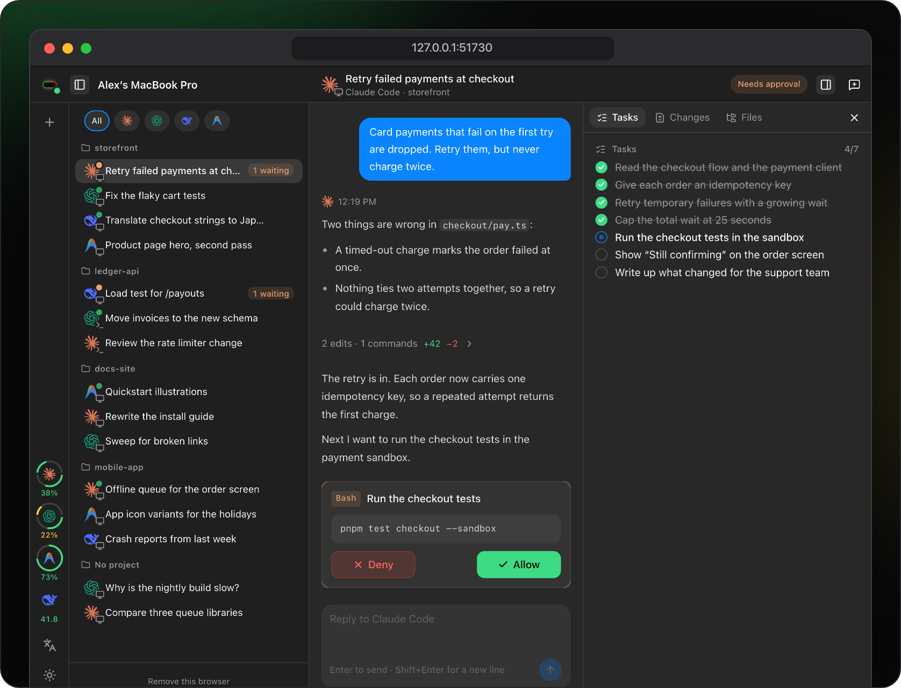
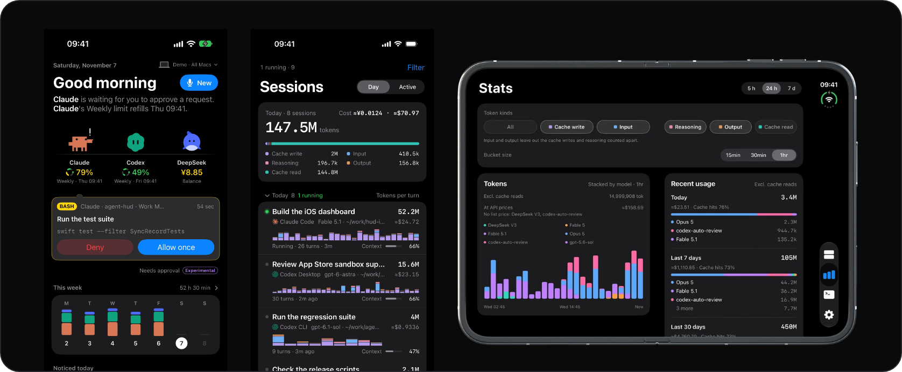
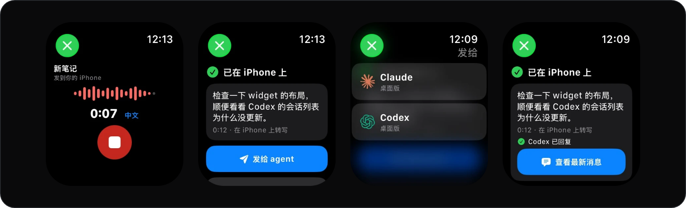
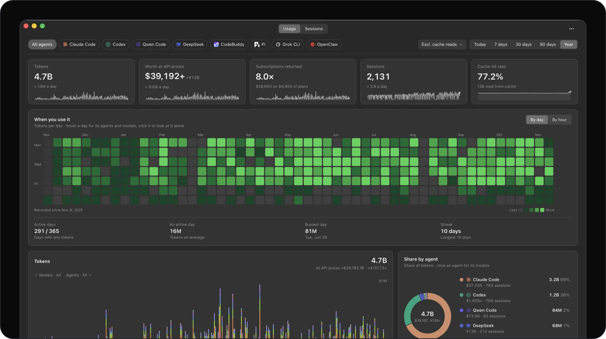

<h1 align="center">Agent HUD</h1>

<p align="center">
  <strong>AI agents 的统一工作台。</strong><br>
  在屏幕上，在手机上，在手腕上。
</p>

<p align="center">
  <a href="https://agenthud.app/mac"></a>
  <a href="https://apps.apple.com/cn/app/agent-hud/id6812113619?uo=4"></a>
  <a href="docs/build-from-source.zh-CN.md"></a>
</p>

<p align="center">
  <a href="README.md">English</a> · <strong>简体中文</strong> · <a href="https://agenthud.app">官网</a> · <a href="https://discord.gg/cpTPDgWwXR">Discord</a> · <a href="#支持的-agent">支持的 agent</a> · <a href="docs/README.md">文档</a>
</p>

<p align="center">
  <br>
  <sub>所有 agent 的会话在同一页，由你自己的电脑提供 · 示例数据</sub>
</p>

Agent 在你的电脑上工作，Agent HUD 把它们放到同一处：看谁在忙、谁在等你，接上一段对话，给出下一个决定。在电脑前，也在离开电脑之后。

## 安装

```sh
brew install --cask jazzenchen/tap/agent-hud     # Mac，用 Homebrew
npx @agenthud/install                            # Mac、Windows 或 Linux，用 Node.js
```

也可以直接下载[发行版](https://agenthud.app/mac)。如果 Agent HUD 对你有用，点个 Star，能让更多人找到它。

## 一个工作台，任何浏览器都能打开

**所有会话，都在一处。** 上面这个页面由[发行版](https://agenthud.app/mac)在你自己的电脑上提供。在这台电脑上打开，或者在同一网络里的手机、平板和另一台电脑上打开。

- **看谁在等你**：每一个会话，按项目分组，带着各自 agent 的标志。
- **当场批准**：允许或拒绝一次工具调用，回答提问，回一句话，或者开一个新会话。
- **跟着进度**：计划做到第几步，以及 agent 在每个文件里改了什么。

## 在屏幕上

**你的 agents，一目了然。** 屏幕边缘告诉你：谁还在忙，谁已经完成，谁正在等你。

<p align="center">
   <br>
  <sub>MacBook 刘海处的刘海形态 · 停在任意屏幕边缘的简约形态 · 示例数据</sub>
</p>

- **光晕**：每个 agent 一种颜色，按它用量最高的那项额度。绿色，已用达到 70% 为黄色，达到 90% 为红色。
- **悬停**：额度及其重置时间、余额、过去 24 小时的 Token，以及会话。
- **请求**：直接在 HUD 上批准、拒绝或回答，再一键回到那个会话。

## 在手机上

**需要做决定时，不必停下脚步。** 在 iPhone 上查看进展、阅读回复、继续对话。agent 遇到只有你能决定的事，就在手机上回答。

<p align="center">
  
</p>

## 在手腕上

**从手腕开始，在 iPhone 上继续。** 抬腕说出一个想法，它就成为家中 Mac 上的一个会话。回复会回到你的手表上。

<p align="center">
  <br>
  <sub>对 Apple Watch 说出的一条笔记，成为 Mac 上的一个 Codex 会话 · 离开家后，手机与手表需要 <a href="#agent-hud-remote">Agent HUD Remote</a></sub>
</p>

## 让 agents 彼此对话

**你的 agents 也在用 Agent HUD。** 通过内置的 MCP 服务，Claude Code 可以请一个 Codex 会话审一遍改动并拿回答复，也可以新开一个会话，把任务交给它。

- **只传消息，不交出会话**：过去的只有 agent 写下的那条消息。项目本身就是它们共同的上下文。
- **打造你自己的界面**：告诉 agent 你想让 HUD 是什么样子，看预览，满意后按**保存**。

[如何让 agents 互发消息](https://agenthud.app/docs/zh/mcp/messaging/)

## 支持的 agent

<p align="center">
  <picture>
    <source media="(prefers-color-scheme: dark)" srcset="docs/videos/agent-bots-row-dark.webp">
    
  </picture>
</p>

安装并登录想要关注的 agent，Agent HUD 会自动发现它们。27 款都能看到 Token 与会话，下面四款功能齐全：

| Agent | 额度 | 实时状态 | 批准 | 提问 | 回复 | 回到会话 | 互发消息 |
| --- | :---: | :---: | :---: | :---: | :---: | :---: | :---: |
| **Claude&nbsp;Code** | ✓ | ✓ | ✓ | ✓ | ✓ | ✓ | ✓ |
| **Codex** | ✓ | ✓ | ✓ | ✓ | ✓ | ✓ | ✓ |
| **Antigravity** | ✓ | ✓ | ✓ | ✓ | ✓ | ✓ | ✓ |
| **DeepSeek&nbsp;Harness** | 余额 | ✓ | ✓ | ✓ | ✓ | 窗口 | ✓ |

<details>
<summary><strong>其余 23 款 agent，以及每一款支持什么</strong></summary>

| Agent | Token 与会话 | 额度 | 实时状态 | 批准 | 提问 | 回复 | 回到会话 | 轮次与调用 | 互发消息 |
| --- | :---: | :---: | :---: | :---: | :---: | :---: | :---: | :---: | :---: |
| **Claude&nbsp;Code** | ✓ | ✓ | ✓ | ✓ | ✓ | ✓ | ✓ | ✓ | ✓ |
| **Codex** | ✓ | ✓ | ✓ | ✓ | ✓ | ✓ | ✓ | ✓ | ✓ |
| **DeepSeek&nbsp;Harness** | ✓ | 余额 | ✓ | ✓ | ✓ | ✓ | 窗口 | ✓ | ✓ |
| **Antigravity** | ✓ | ✓ | ✓ | ✓ | ✓ | ✓ | ✓ | ✓ | ✓ |
| **Cursor** | ✓ | ✓ | ✓ |  |  | ✓ | ✓ |  | 受限 |
| **Grok&nbsp;CLI** | ✓ | ✓ | ✓ |  |  | ✓ |  |  |  |
| **Grok&nbsp;Bot** | ✓ | ✓ | ✓ |  |  | ✓ | ✓ |  |  |
| **GitHub&nbsp;Copilot&nbsp;CLI** | ✓ | ✓ | ✓ | ✓ |  | ✓ |  |  |  |
| **OpenCode** | ✓ | ✓ |  |  |  | ✓ | ✓ |  | ✓ |
| **Kilo&nbsp;Code** | ✓ |  |  |  |  | ✓ | ✓ |  |  |
| **MiMo&nbsp;Code** | ✓ |  |  |  |  | ✓ | ✓ |  |  |
| **Kimi** | ✓ | ✓ | ✓ |  |  | ✓ |  |  | 受限 |
| **Pi** | ✓ | ✓ | ✓ |  |  | ✓ | ✓ |  | ✓ |
| **Oh&nbsp;My&nbsp;Pi** | ✓ |  | ✓ |  |  | ✓ | ✓ |  |  |
| **OpenClaw** | ✓ |  |  |  |  |  |  |  |  |
| **Hermes&nbsp;Agent** | ✓ | ✓ | ✓ |  |  | ✓ |  |  |  |
| **Factory&nbsp;Droid** | ✓ | ✓ | ✓ | ✓ |  | ✓ |  |  |  |
| **TRAE** | 会话 | ✓ | ✓ |  |  | ✓ |  |  | 受限 |
| **Qoder** | ✓ | ✓ | ✓ | ✓ |  | ✓ |  | ✓ | 受限 |
| **ZCode** | ✓ |  | ✓ | ✓ | ✓ | ✓ |  |  | 受限 |
| **CodeBuddy** | ✓ |  |  | ✓ |  | ✓ |  |  |  |
| **WorkBuddy** | ✓ | ✓ |  | ✓ |  | ✓ |  |  | 受限 |
| **Qwen&nbsp;Code** | ✓ |  |  | ✓ |  | ✓ |  |  |  |
| **Devin** | ✓ | ✓ |  | ✓ |  | ✓ | ✓ |  |  |
| **Cline** | ✓ | ✓ |  |  |  |  |  |  |  |
| **Roo&nbsp;Code** | ✓ |  |  |  |  |  |  |  |  |
| **Goose** | ✓ |  |  |  |  |  |  |  |  |

互发消息标着**受限**的，消息只在这一轮结束时送到：空闲的会话收不到，要等你在那里再发起一轮。

另外还读取 **GLM Coding Plan**、**OpenCode Go**、**MiniMax** 与 **火山方舟** 的套餐额度。Qoder 包括 Qoder CN 与 QoderWork，TRAE 包括 TRAE CN，Devin 包括 CLI 与 Devin Desktop。Codex CLI 的批准需先在 Codex 中信任回调（Codex 桌面版不需要），DeepSeek Harness 的批准和提问需先安装 Agent HUD 插件（设置 → 智能体插件），Copilot 的批准与额度分别在设置中打开。Qoder、WorkBuddy 与 TRAE 的额度需先在 Agent HUD 自己的窗口里登录厂商网站。TRAE 不提供 Token，只显示会话；打开它的全局 Hooks 后才会运行 Agent HUD 的回调。Qoder 只在使用你自己密钥的模型、或设置了 `QODER_EXPOSE_TOKEN_USAGE` 时记录 Token，逐轮明细也随之才有。一键回到终端窗格需要 iTerm2；Cursor 能回到云端 agent 的对话，本地对话只能打开它的文件夹。DeepSeek Harness 的一键回到只把桌面版的窗口带到前面（macOS 与 Windows），还回不到具体会话；Windows 上的链接已带上会话，等 Harness 支持后就能直接打开。[互发消息](https://agenthud.app/docs/zh/mcp/messaging/)标为「受限」的 agent 只在自己的一轮结束时收消息，空闲时收不到，也不能被新开会话；只有交互式的 Qoder CLI 会话空闲时也收得到。OpenCode 2、Qoder CN 与 QoderWork 只收不发。Factory Droid 的额度需要 Factory API Key，Devin 的额度来自其 CLI 的本机缓存。Cursor 的 Token 需要 Cursor 3.27 或更新版本。Grok Bot 的 Bot 运行在 Cursor 的服务器上，由服务器给出每个 Bot 每天的 Token；已合并到 SuperGrok 的账户没有这项数据，只显示会话。Cursor 与 Grok Bot 登录同一账户时，Grok Bot 的周额度也从这些服务器读取；否则读取 Bot 自己的缓存，而 Bot 只在使用时刷新它。已合并到 SuperGrok 的账户由 Cursor 和 Grok Bot 共用一个周额度，Cursor 一栏按 Cursor 自己的显示读取它。

</details>

## 看清 Token 用量

**额度告诉你还剩多少，Token 用量让你看懂它是怎么花掉的**：哪些 agent、模型和会话，以及随时间怎样变化。

<p align="center">
  
</p>

| 维度 | 可以追踪 |
| --- | --- |
| **时间** | 今天、近 7 天、30 天、90 天或一年。每个 Token 都留在你的电脑上。 |
| **Agent&nbsp;与模型** | 每个 agent 的占比、Token 与费用，以及用到的模型。 |
| **会话与轮次** | 会话的 Token（含子 agent 的部分）、上下文占用与缓存命中。 |
| **费用与订阅** | 按标价估算的费用，以及每个订阅的用量按 API 标价值多少。 |

## 占用小

**HUD 需要长时间运行，轻量常驻本身就是产品体验。** 下面是在真实 Mac 上闲时测到的数字：

<!-- 数字来自按 docs/performance.md 测量的发布构建。 -->
<table>
  <tr>
    <td align="center" width="33%"><h3>约 7%</h3>单核 CPU</td>
    <td align="center" width="33%"><h3>约 240 MB</h3>内存</td>
    <td align="center" width="33%"><h3>约 0.1 Wh</h3>8 小时的能耗</td>
  </tr>
</table>

基于 Tauri 2 构建：Rust 核心、React 界面，每个操作系统各有一层很薄的原生代码。macOS 与 Windows 已可用，Linux 处于预览。[测量方法](docs/performance.md#measured-footprint)

## Agent HUD Remote

**走到哪里，agents 都在身边。** 在同一个网络里，标 ✓ 的都免费。Remote 经由你自己的 iCloud 把它们带到任何网络，再加上标 ★ 的。

| | iPhone | Apple Watch |
| --- | :---: | :---: |
| 额度、余额、Token 统计与会话 | ✓ | ✓ |
| 对话，以及给 agents 发消息 | ★ | ★ |
| 工具调用、提问与计划 | ★ | ★ |
| 说出的一条笔记变成新会话 | ★ | ★ |
| 提醒与实时活动 | ★ | ★ |

<sub>✓ 免费使用 · ★ 需要订阅</sub>

**在 App Store 订阅**，在 iPhone App 里完成：[中国区](https://apps.apple.com/cn/app/agent-hud/id6812113619) · [国际区](https://apps.apple.com/us/app/agent-hud/id6812113619)

## 保护你的数据

- **在你的电脑上读取**：agent 本来就在保存的记录。用量历史留在本地数据库里。
- **从各家读取**：额度与余额，用 agent 已有的登录。任何一次读取都不会给模型发消息。
- **上传**：从本仓库源码构建的版本不上传任何东西。

发行版发给 iPhone 与 Apple Watch 的内容，以及怎样加密：[你的数据](docs/data.zh-CN.md)。

## 更多

[即将推出](docs/roadmap.zh-CN.md) · [常见问题](docs/common-questions.zh-CN.md) · [从源码构建](docs/build-from-source.zh-CN.md) · [文档](docs/README.md) · [Discord](https://discord.gg/cpTPDgWwXR) · [微信群](docs/community.zh-CN.md) · [Apache-2.0](LICENSE)
