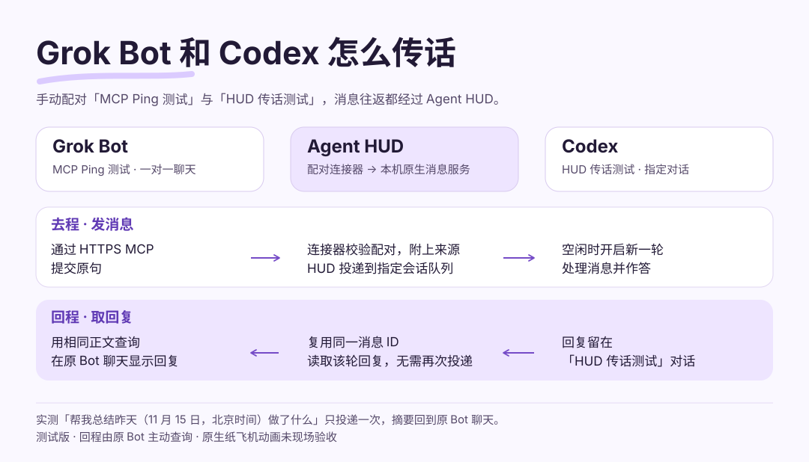

# Paired Grok Bot messaging on macOS

This opt-in example connects one manually paired Grok Bot chat to one Codex
thread. It uses the installed Agent HUD engine's user-local application channel
and the existing native messaging journal and Codex queue. A Grok Bot HTTPS MCP
call supplies the text. A later call with the same text returns the Codex reply
to that Bot chat. Network transport and pairing run in the example process.



## Run

Requirements are a running macOS Agent HUD release with Agent messages enabled,
a Grok Bot that Agent HUD already sees, a Codex test thread, and Python 3.9 or
later. This is a developer example with no app settings UI or automatic setup.

1. Get the full Grok Bot session ID from Agent HUD's local session listing
   (`hud_sessions` in its MCP) and the target Codex thread ID from `list_sessions`.
   Set the following variables in the terminal running the example.

   ```sh
   export GROK_NATIVE_PAIRED_BOT_ID='<full grok-bot session ID>'
   export GROK_NATIVE_CODEX_THREAD_ID='<Codex thread UUID>'
   export GROK_NATIVE_STATE_DIR='<private directory for this pairing>'
   export GROK_NATIVE_KEY="$(openssl rand -hex 32)"
   export GROK_NATIVE_PAIR_PROOF="$(openssl rand -hex 16)"
   python3 examples/grok-bot-messaging/server.py
   ```

   Set `AGENT_HUD_ENGINE` if the engine lives outside the installed app.

2. Route HTTPS to this example's loopback listener at `127.0.0.1:18766`.
   In Grok Bot, add a Remote HTTPS connector with the URL ending in `/mcp` and
   `X-HUD-Test-Key` set to the generated connector key. Use a trusted HTTPS
   endpoint because it carries message and reply text.
3. In a private one-to-one chat with the paired Bot, ask it to call
   `paired_codex_exchange` with the message and pairing code
   (`GROK_NATIVE_PAIR_PROOF`). If it receives a pending status, call again with
   identical text and code to retrieve the reply. The pair code is a
   session-scoped capability chosen by the operator, not a Bot ID asserted by
   Grok's transport. Choose a dedicated test chat and keep the code there.
4. Stop the example and close the HTTPS route to disable it. Use a fresh
   state directory and credentials to start a new pairing.

The caller and destination are fixed locally. The HTTP interface accepts no
session IDs, RPC method names or arbitrary journal lookups. The example stores
a keyed fingerprint, the HUD message ID, and status, while replies are held in
memory. Matching text is treated as one request per pairing. An interrupted
submission with unknown acceptance is never replayed automatically.

## Observed on macOS

- Two real Grok Bot tool calls carrying the same test text produced one inbound
  Codex message in the earlier queue prototype.
- The manually paired native round trip recorded Grok Bot as the sender, queued
  one Codex turn, and returned the Codex echo to the original Bot chat.
- A real Chinese plain-text request entered the target Codex thread once, and
  the resulting summary appeared in the same Grok Bot one-to-one chat.
- Native send and answer records were observed. Both desktop paper-plane
  animations were not independently observed. The tested release displayed a
  fallback Codex sender label. The accompanying Rust change corrects that label
  and has a focused regression test.
- These are prototype observations from the installed macOS release; the
  example has no Windows/Linux integration or official Grok chat identity
  attestation. Replies are fetched by the originating Bot, with no webhook
  push to a closed turn.

Run the connector regression test with
`python3 -m unittest discover -s examples/grok-bot-messaging` from the repository root.
